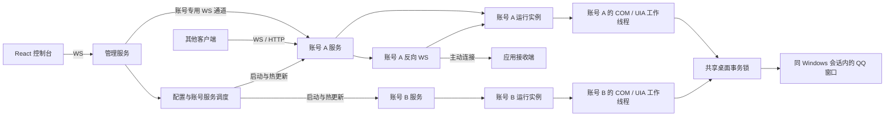

# 项目架构

QuitBot 由 Python 后端、React 控制台和类型化协议组成。后端统一使用根目录的 `pyproject.toml`、`uv.lock` 与 `src/` 布局，模块入口为 `python -m quitbot_backend`。

## 目录与职责

| 路径 | 职责 |
| --- | --- |
| `src/quitbot_backend/__main__.py` | 启动管理服务和各账号服务 |
| `src/quitbot_backend/app.py` | 账号 HTTP / WS 路由、认证接入、OpenAPI |
| `src/quitbot_backend/contracts.py` | 账号动作目录、请求与返回类型 |
| `src/quitbot_backend/runtime.py` | 单账号生命周期、动作调度和事件订阅 |
| `src/quitbot_backend/reverse_ws.py` | 按账号建立反向 WS，处理握手、收发、重连与关闭 |
| `src/quitbot_backend/config.py`、`auth.py` | 配置校验与持久化、密码校验和会话管理 |
| `src/quitbot_backend/discovery.py` | 本 Windows 会话的 QQ 进程枚举、连接时的账号资料读取、结果模型 |
| `src/quitbot_backend/_webui/` | 前端生成的静态资源与第三方许可声明，随 Python 包分发，Git 忽略 |
| `src/quitbot_backend/service.py`、`management.py` | 配置热更新、账号服务调度和管理接口 |
| `src/quitbot_backend/_engine/` | UIA 操作、领域数据、OneBot 转换和本地消息索引 |
| `frontend/src/` | React + TypeScript 界面，`transport.ts` 处理 WS 请求、回执和事件 |
| `frontend/src/generated/` | 由账号和管理 OpenAPI 生成的 TypeScript 类型 |
| `protocol/` | OpenAPI 与动作目录 |
| `tests/` | 后端回归检查 |
| `config/` | 自动生成的账号配置、凭证和运行状态 |
| `docs/` | 能力、接口与使用文档 |

前端独立构建，由本机后端托管静态页面；开发模式由 Vite 代理同源登录与配置 WS。管理与业务请求均通过同源 WS，其中业务通道按账号隔离，与对外监听端口独立。其他应用可通过正向 WS、反向 WS 或 HTTP 接入同一账号实例；OpenAPI 和生成的类型负责描述接口。

## 管理服务与配置生命周期

本机控制台服务默认监听 `127.0.0.1:6699`，提供登录页、密码登录和配置管理。首次启动生成随机临时密码，首次登录只能改密、查询会话或退出；改密后才进入控制台。密码以随机盐和 PBKDF2-HMAC-SHA256 摘要持久化。

会话仅保存在后端内存中，默认有效 4 小时，由 `webui.session_hours` 配置。修改后新签发的会话使用新时长，既有会话保留到期时间；网页刷新和业务调用不续期。管理与账号服务共同校验会话，退出或到期后关闭相关正向 WS，改密撤销全部已有会话。反向连接使用接收端令牌，独立于控制台登录状态。前端先验证会话，再挂载控制台页面。

WebUI 地址、端口和登录保护放在运行配置的 `webui` 中。地址与端口在启动时读取，修改后报告等待重启；登录保护随配置热更新。各 QQ 账号的服务端口和设置单独保存。

账号连接页每次进入时提交一次进程探查，后端启动保持空闲。扫描在工作线程中只调用 Win32 枚举同会话的 QQ 进程窗口，返回进程名、PID 和 HWND。管理服务缓存进程列表；手动刷新合并正在进行的同一次扫描，关闭服务时等待已提交任务结束。

显式连接时才初始化 COM，沿用 UIA 桌面锁读取所选窗口的 QQ 号、昵称和头像，并完成绑定核验。账号绑定时也按 HWND 限定资料读取范围。完整资料在连接成功后单独缓存在内存，普通刷新只核对进程窗口是否仍存在；头像通过 UIA 控件截图读取。账号设置从已激活资料缓存生成列表。

`ConfigStore` 校验配置，使用临时文件和原子替换完成保存。保存请求携带读取时的 `revision`，用于检测并发修改。`Service` 每秒检查配置文件变化，只重建受影响的账号服务；重建前等待在途 UI 操作，随后尝试恢复原有绑定和监听状态。

格式错误的配置会保留当前运行实例。账号服务启动失败时，返回分账号错误并尝试恢复原服务。配置快照中的 `revision` 表示期望配置，`applied_revision` 表示最后一次完整应用的配置。调用方同时检查版本和 `errors`，具体流程见[配置与热更新](configuration.md)。

控制台收到账号 WS 的 `1012` 更新通知后，通过管理通道等待该账号就绪，再恢复原账号连接。恢复保留页面和本地操作记录，只执行认证及元数据读取，不重发业务请求。资料读取对主窗口控件和头像渲染作有界等待；原生实例连接时已核验的 QQ 号直接供运行时使用，避免立即重复打开资料卡。

## 一个账号一个服务

每条账号配置创建一个独立 `AccountRuntime`，HTTP 与正向 WS 按各自配置创建监听端点。相同地址和端口共用一个监听端点，运行实例及反向连接只启动一次；关闭全部对外监听后，控制台账号通道仍可使用。绑定时读取窗口身份，核验结果须与 `account_id` 一致；`label` 用于展示。

`targets` 限定可操作和监听的会话。会话名称用于定位，数字 ID 用于核验。各账号分别保存 `state/<account_id>/messages.sqlite3`，记录本地 UI 消息与协议消息 ID 的映射。

业务数据来自 QQ 原生界面和本地映射索引。索引中的消息 ID 只在所属账号下使用，详见 [OneBot 消息标识](onebot11.md#消息标识与时间)。

## 异步调度与操作收尾

正向与反向连接共用 `AccountRuntime.handle()`，各自订阅账号事件。反向连接随账号服务启动和停止，按配置间隔重连；关闭时先停止外连，再等待在途动作完成。热更新仅影响配置发生变化的账号。

网络调用和监听生命周期采用异步接口，同账号业务动作串行执行。Windows COM / UIA 在账号专属工作线程中运行，跨实例的 GUI 操作通过共享桌面事务锁协调焦点。独立 Windows 会话可用于隔离自动化与日常桌面操作。

一次控件操作包含目标核验、执行、结果读取和界面收尾。取消网络等待后，已提交的控件操作继续完成；关闭和重配置会等待在途动作。提交后无法确认结果时，返回“结果未知”，调用方先查询实际状态，再决定是否重试。

## 监听与事件

消息源和通知源复用账号的原生工作线程：

- `detached`（默认）：每个配置会话分别打开一个独立聊天窗口并轮询。
- QQ 会话列表采用虚拟滚动。独立窗口打开时，若会话行尚未加载，通过 UIA 滚动定位，再重新定位已聚焦的控件。快捷键未弹出菜单时，尝试 UIA 原生上下文菜单；打开窗口的动作只执行一次。已打开的窗口直接复用，成功后缓存已核验的句柄。
- `switch`：切换配置会话进行轮询。
- `refresh_detached`：允许主动刷新独立窗口，可能激活窗口。
- `activities`：观察请求卡片和系统通知。
- `track_roster`：观察已加载成员列表的变化。

消息读取依赖 QQ 更新和加载界面内容。标准字段齐全的观察转换成 OneBot 事件，其余通过 `quitbot` 扩展保留原文和原因。完整事件范围见 [OneBot 适配](onebot11.md)。

每个 WS 订阅者有 128 条事件缓冲，溢出时以 1013 关闭该连接。事件实时推送，断线期间的事件不补发。控制台分别展示服务连接、QQ 绑定和监听状态。
